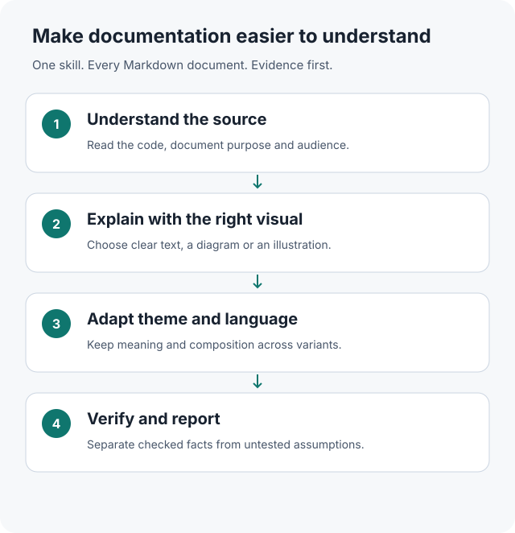

# GitHub Markdown Studio

**One skill. Every Markdown document. Evidence first.**

English · [ไทย](README.th.md)

Create, improve, audit and synchronize GitHub documentation—not just READMEs. Make guides, architecture notes, references and runbooks easier to understand with appropriate visuals, matching light/dark assets, and deliberate multilingual workflows.

> [!IMPORTANT]
> **This is an evolving implementation, not a benchmark winner or a universal agent certification.** The skill supplies agent instructions and tested offline helpers. AI illustration generation requires an image tool from the host agent; the bundled SVG generator is deterministic, not AI-generated imagery.

## Install

Once the skill is available on the repository's default branch:

```bash
npx skills add whale-devx/github-markdown-studio-skills --skill github-markdown-studio
```

For a development checkout, install from the local repository directory instead:

```bash
npx skills add . --skill github-markdown-studio
```

Add `-g` to install at user scope, or `-a <agent-id>` to choose a supported agent. The current Skills CLI documents Node.js 22.20+; consult its [installation reference](https://github.com/vercel-labs/skills/blob/main/docs/commands.md). Installation makes the instructions available; it does not add image-generation tools or browser access to your agent.

**Try it after installation.** Open this checkout in your agent and ask:

> Use github-markdown-studio to audit README.md. Which installation steps might a new contributor find unclear?

## Works across agent and model providers

The skill is **provider-agnostic**: one standard `SKILL.md`, without a required model API, SDK, token, proprietary tool, or provider-specific fork. It can be installed through any compatible Agent Skills loader. The Skills CLI lists Claude Code, Codex, Gemini CLI, Cursor, GitHub Copilot, OpenCode, Windsurf, Cline, Roo Code and others; **CLI support does not mean this project has tested those agents end to end**. [See the portability contract](skills/github-markdown-studio/references/agent-portability.md).

Always select behavior by the **tools actually available in the host** rather than the model name. Python, image generation, image editing, web access and a browser are optional. If an AI image is requested without an image tool, the result must say `blocked` rather than disguise an SVG or a prompt as generated imagery. Language drafts still require linguistic review.

The offline preflight reads a deliberately provided capability inventory and recommends methods; it does not auto-detect hosts or execute the tasks:

```bash
python skills/github-markdown-studio/scripts/capability_plan.py --input examples/host-capabilities.json
```

Available methods, not successful outcomes, are reported. Native installation and activation in each provider remain separate integration tests.

## Ask for an outcome

```text
Use github-markdown-studio to improve docs/ for new contributors.
Preserve verified facts and existing brand assets.
Support light and dark themes, and produce English and Thai versions.
Use diagrams or generated illustrations only where they improve understanding.
Report what was checked and what could not be verified.
Do not change application code or repository settings.
```

For a non-editing review, ask for `audit`. The other modes are `create`, `improve` and `sync`. Limit the request to a file, folder or an explicit repository-wide pass.

## What is included

| Capability | Implementation in this version |
| --- | --- |
| Beyond README | Document-specific instructions for guides, references, architecture, runbooks, changelogs and agent files |
| Light and dark | Native GitHub formatting, paired image guidance and an offline two-theme SVG generator |
| Multiple languages | Translation workflow, glossary, locale navigation and source/target drift checks; English/Thai examples included |
| Explanatory visuals | Mermaid guidance, deterministic SVG generation and a capability-aware host image-generation workflow |
| Verification | Read-only local checks, explicit untested states and regression tests |
| Safe editing | Scope boundaries, preserved frontmatter, evidence requirements and no implicit publishing |
| Cross-agent portability | Standard Agent Skills instructions and an optional capability-only preflight, with no model SDK |

Other locales can follow the workflow, but are not all linguistically or visually tested. The helpers do not automatically translate prose, execute quick starts, contact remote links, render Mermaid or certify GitHub's actual output.

## Advanced formatting, beyond README

All ten topics in GitHub's advanced-formatting catalog have source-backed guidance, English/Thai examples and explicit audit limits: tables, collapsed sections, code blocks, diagrams, math, autolinks, attachments, task lists, permanent code links and workflow keywords. Diagram guidance includes **Mermaid, GeoJSON, TopoJSON and ASCII STL**, not Mermaid alone.

The audit now distinguishes repository files from conversation/workflow text using `--surface` and `--pr-target`. It performs bounded structural checks, not full grammar validation or live rendering. No provider SDK, model-specific fork, image service or extra package is required by this addition.

[Formatting guide](skills/github-markdown-studio/references/advanced-formatting.md) · [English showcase](examples/advanced-formatting.en.md) · [Thai showcase](examples/advanced-formatting.th.md) · [Coverage and limits](skills/github-markdown-studio/assets/formatting-coverage.json)

## How it works

<picture>
  <source media="(prefers-color-scheme: dark)" srcset="examples/assets/workflow.en.dark.svg">
  <source media="(prefers-color-scheme: light)" srcset="examples/assets/workflow.en.light.svg">
  
</picture>

The same process and layout appear in both themes. This diagram is generated from [localized JSON](examples/workflow.json), not an image model. [View the visual examples](examples/README.md).

## Offline helpers

The skill works as instructions without Python. Its optional helpers require Python 3.10+; only the audit helper needs additional packages. From a checkout:

```bash
python -m pip install -r skills/github-markdown-studio/scripts/requirements.txt
python skills/github-markdown-studio/scripts/audit.py . --translations i18n-manifest.json --strict
python -m unittest discover -s tests -v
```

Generate both themes for every locale in a diagram specification:

```bash
python skills/github-markdown-studio/scripts/render_diagram.py examples/workflow.json --output /tmp/studio-assets
```

Existing output files are protected unless `--force` is explicitly supplied. See the [usage guide](docs/usage.md) for installed-skill paths, JSON reports and limitations.

## Explore

[Skill instructions](skills/github-markdown-studio/SKILL.md) · [Usage](docs/usage.md) · [Architecture](docs/architecture.md) · [Validation](docs/validation.md) · [Roadmap](docs/roadmap.md) · [Contributing](CONTRIBUTING.md)

## License

[MIT](LICENSE). Existing project branding and license obligations must be preserved when this skill edits another repository.
