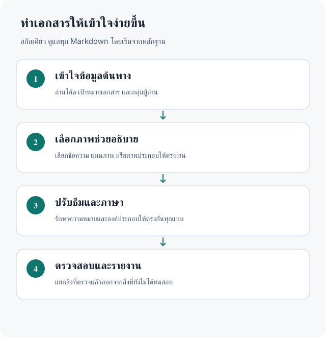

# GitHub Markdown Studio

**สกิลเดียว ดูแลทุก Markdown โดยเริ่มจากหลักฐาน**

[English](README.md) · ไทย

สร้าง ปรับปรุง ตรวจสอบ และปรับเอกสารบน GitHub ให้ตรงกับข้อมูลล่าสุด ไม่จำกัดเฉพาะ README ช่วยให้คู่มือ สถาปัตยกรรม เอกสารอ้างอิง และคู่มือดูแลระบบเข้าใจง่ายขึ้น ด้วยภาพที่เหมาะกับเนื้อหา ภาพคู่ธีม Light/Dark และขั้นตอนดูแลเอกสารหลายภาษา

> [!IMPORTANT]
> **v0.1.0 เป็นการพัฒนารุ่นแรก ยังไม่มีผลยืนยันว่าเหนือกว่าสกิลอื่น** มีคำสั่งสำหรับ agent และเครื่องมือออฟไลน์ที่ผ่านชุดทดสอบ การสร้างภาพประกอบด้วย AI ต้องใช้เครื่องมือสร้างภาพของ agent ส่วนตัวสร้าง SVG ที่ให้มาเป็นการวาดแบบกำหนดโครงสร้าง ไม่ใช่ภาพจากโมเดล AI

## ติดตั้ง

เมื่อสกิลอยู่บน default branch ของ repository แล้ว:

```bash
npx skills add whale-devx/github-markdown-studio-skills --skill github-markdown-studio
```

สำหรับ checkout ที่กำลังพัฒนา ให้ติดตั้งจากโฟลเดอร์ repository ในเครื่องแทน:

```bash
npx skills add . --skill github-markdown-studio
```

เพิ่ม `-g` เพื่อติดตั้งระดับผู้ใช้ หรือ `-a codex` เพื่อเลือก agent นั้น เอกสาร Skills CLI ปัจจุบันระบุ Node.js 22.20 ขึ้นไป ดูรายละเอียดใน [คู่มือติดตั้ง](https://github.com/vercel-labs/skills/blob/main/docs/commands.md) การติดตั้งเพิ่มชุดคำสั่งให้ agent แต่ไม่ได้เพิ่มเครื่องมือสร้างภาพหรือสิทธิ์เข้าถึงเบราว์เซอร์ให้โดยอัตโนมัติ

## ระบุผลลัพธ์ที่ต้องการ

```text
ใช้ github-markdown-studio ปรับเอกสารใน docs/ สำหรับผู้ร่วมพัฒนาใหม่
รักษาข้อเท็จจริงที่มีหลักฐานและภาพลักษณ์เดิมของโปรเจกต์
รองรับธีม Light/Dark และจัดทำฉบับภาษาอังกฤษกับภาษาไทย
ใช้แผนภาพหรือภาพประกอบที่สร้างขึ้นเฉพาะเมื่อช่วยให้เข้าใจง่ายขึ้น
รายงานสิ่งที่ตรวจแล้วและสิ่งที่ยังยืนยันไม่ได้
ไม่แก้โค้ดแอปพลิเคชันหรือการตั้งค่า repository
```

ใช้โหมด `audit` เมื่อต้องการตรวจโดยไม่แก้ไฟล์ ส่วนโหมดอื่นคือ `create`, `improve` และ `sync` ระบุขอบเขตเป็นไฟล์ โฟลเดอร์ หรือทั้ง repository อย่างชัดเจน

## สิ่งที่มีในรุ่นนี้

| ความสามารถ | การทำงานในรุ่นนี้ |
| --- | --- |
| ไม่จำกัด README | คำแนะนำตามประเภทเอกสาร ทั้งคู่มือ เอกสารอ้างอิง สถาปัตยกรรม คู่มือดูแลระบบ บันทึกการเปลี่ยนแปลง และไฟล์สำหรับ agent |
| Light และ Dark | ใช้รูปแบบที่ GitHub รองรับ มีแนวทางภาพคู่ธีมและตัวสร้าง SVG สองธีมแบบออฟไลน์ |
| หลายภาษา | ขั้นตอนแปล อภิธานศัพท์ ลิงก์เลือกภาษา และการตรวจคำแปลที่ต้องทบทวน พร้อมตัวอย่างอังกฤษ–ไทย |
| ภาพช่วยอธิบาย | แนวทาง Mermaid ตัวสร้าง SVG และขั้นตอนใช้เครื่องมือสร้างภาพของ agent เมื่อมี |
| การตรวจสอบ | ตรวจในเครื่องแบบอ่านอย่างเดียว ระบุสิ่งที่ยังไม่ได้ทดสอบ และมีชุดทดสอบป้องกันข้อผิดพลาดซ้ำ |
| การแก้ไขอย่างจำกัด | รักษาขอบเขต frontmatter และหลักฐาน ไม่เผยแพร่การแก้ไขเองโดยพลการ |

ภาษาอื่นใช้ขั้นตอนเดียวกันได้ แต่ยังไม่ได้ตรวจคุณภาพภาษาและการแสดงผลครบทุกภาษา เครื่องมือที่ให้มาไม่แปลข้อความอัตโนมัติ ไม่รันคำสั่งเริ่มใช้งาน ไม่ติดต่อ URL ภายนอก ไม่เรนเดอร์ Mermaid และไม่รับรองผลการแสดงบน GitHub จริง

## ขั้นตอนการทำงาน

<picture>
  <source media="(prefers-color-scheme: dark)" srcset="examples/assets/workflow.th.dark.svg">
  <source media="(prefers-color-scheme: light)" srcset="examples/assets/workflow.th.light.svg">
  
</picture>

ทั้งสองธีมใช้ขั้นตอนและตำแหน่งองค์ประกอบเดียวกัน ภาพนี้สร้างจาก [JSON หลายภาษา](examples/workflow.json) ไม่ใช่โมเดลสร้างภาพ ดูเพิ่มเติมใน [ตัวอย่างภาพและแผนภาพ](examples/README.md)

## เครื่องมือออฟไลน์

ใช้คำสั่งของสกิลได้โดยไม่ต้องมี Python ส่วนเครื่องมือเสริมต้องใช้ Python 3.10 ขึ้นไป และเฉพาะตัวตรวจเอกสารที่ต้องติดตั้งแพ็กเกจเพิ่ม รันจาก checkout:

```bash
python -m pip install -r skills/github-markdown-studio/scripts/requirements.txt
python skills/github-markdown-studio/scripts/audit.py . --translations i18n-manifest.json --strict
python -m unittest discover -s tests -v
```

สร้างภาพสองธีมสำหรับทุกภาษาที่ระบุในไฟล์แผนภาพ:

```bash
python skills/github-markdown-studio/scripts/render_diagram.py examples/workflow.json --output /tmp/studio-assets
```

ไฟล์ผลลัพธ์เดิมจะไม่ถูกเขียนทับ เว้นแต่ระบุ `--force` อ่านวิธีอ้างอิงสกิลที่ติดตั้ง การรายงาน JSON และข้อจำกัดใน [คู่มือใช้งาน](docs/usage.md)

## เอกสารที่เกี่ยวข้อง

[คำสั่งของสกิล](skills/github-markdown-studio/SKILL.md) · [วิธีใช้งาน](docs/usage.md) · [สถาปัตยกรรม](docs/architecture.md) · [ผลตรวจสอบ](docs/validation.md) · [แผนพัฒนา](docs/roadmap.md) · [ร่วมพัฒนา](CONTRIBUTING.md)

## ใบอนุญาต

[MIT](LICENSE) เมื่อสกิลแก้เอกสารของ repository อื่น ต้องรักษาอัตลักษณ์และข้อกำหนดใบอนุญาตเดิมของโปรเจกต์นั้นด้วย
