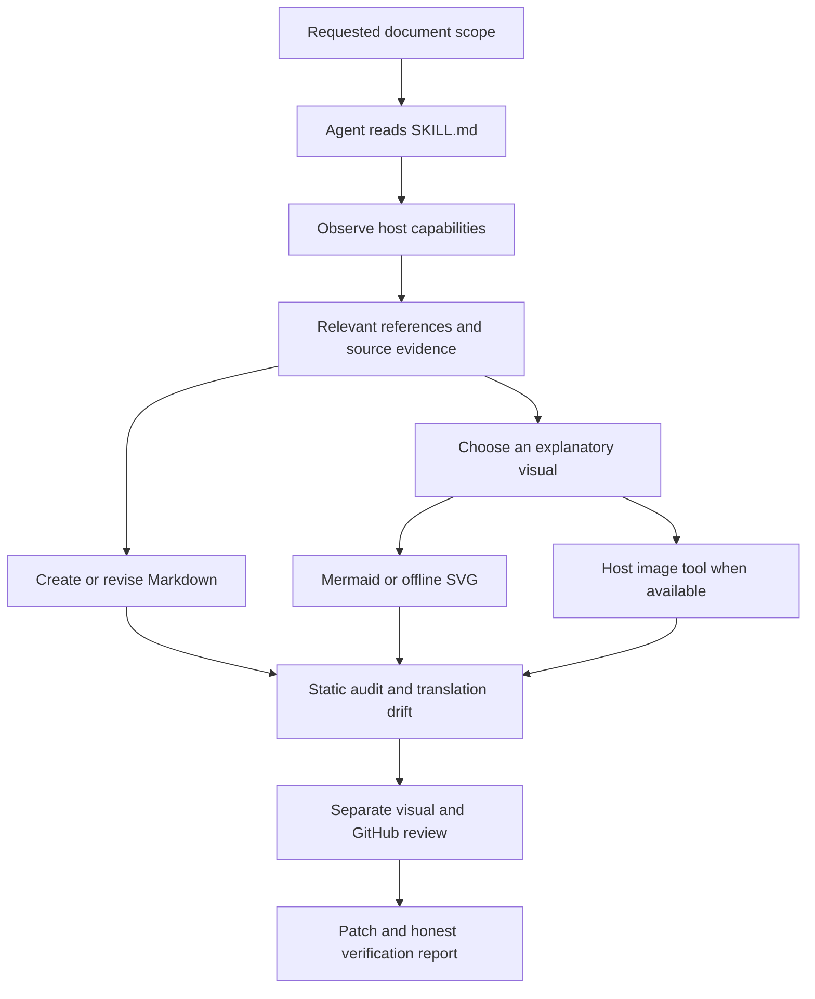

# Architecture

[Home](../README.md)

## One entry point, optional capabilities

`SKILL.md` is the agent-facing entry point. Focused references are loaded as needed. The host agent performs writing and translation. Bundled Python helpers perform narrower deterministic checks and SVG generation; they are not an autonomous LLM service.

This describes the intended skill workflow, not a runtime orchestrator implemented by the Python scripts. Mermaid rendering must be checked separately.

## Components

| Component | Responsibility |
| --- | --- |
| `skills/github-markdown-studio/SKILL.md` | Scope, mode selection and workflow |
| `references/` inside the skill | Document design, GitHub behavior, multilingual work, visual generation and verification |
| `scripts/audit.py` | Offline read-only checks using Markdown tokens and selected HTML inspection |
| `scripts/capability_plan.py` | Optional, standard-library-only method selection from explicitly supplied host capabilities; never discovers agents or executes work |
| `references/agent-portability.md` | Cross-agent installation guidance, permission boundaries and truthful compatibility reporting |
| `scripts/render_diagram.py` | Deterministic localized light/dark SVGs from JSON |
| `assets/` inside the skill | Image brief and glossary templates |
| `i18n-manifest.json` | Reviewed source/translation byte snapshots |
| `tests/` | Executed regression checks for helper behavior |
| `evals/` | Proposed agent-level evaluation scenarios; not benchmark results |

## Provider-neutral boundary

The skill contains no LLM SDK or provider-specific execution branch. An Agent Skills-compatible host loads `SKILL.md`; its actual tools, permissions and sandbox determine what work can happen. The capability inventory has three states (`true`, `false`, `unknown`). For optional operations, choose a host-native tool by *capability*, not by model name. A capability preflight report is a plan, not proof of execution or agent activation.

Image generation, image editing, browser screenshots and live GitHub checks must be confirmed separately. Offline SVG and Mermaid are deliberate alternatives, never mislabeled AI imagery. See the [portability reference](../skills/github-markdown-studio/references/agent-portability.md).

## Trust boundary

The audit root is the local file boundary. The helper does not follow paths outside it, execute repository commands, fetch remote images or contact links. Common build/dependency directories are excluded from directory scans. It is not an operating-system sandbox and should not run with elevated privileges on a hostile changing filesystem.

Only the host can supply image generation, browser access and project-specific execution. Missing tools stay explicit. Image generation is not faked with a placeholder path or an unexecuted prompt.

## Design tradeoffs

The checker uses a real Markdown tokenizer rather than matching every link with a single regular expression. Heading fragments remain an approximation, so uncertain anchors are warnings. Translation hashes detect byte changes, not semantic correctness. The SVG renderer deliberately restricts layout and label length for predictable pairs rather than claiming to be a general-purpose graphics system.
