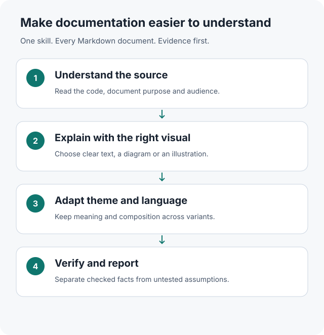
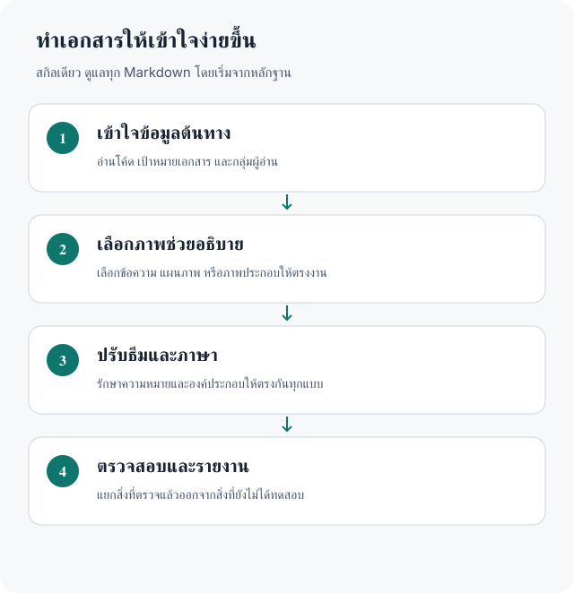

# Visual examples

[Home](../README.md)

## English: matching themes

<picture>
  <source media="(prefers-color-scheme: dark)" srcset="assets/workflow.en.dark.svg">
  <source media="(prefers-color-scheme: light)" srcset="assets/workflow.en.light.svg">
  
</picture>

[Open light](assets/workflow.en.light.svg) · [Open dark](assets/workflow.en.dark.svg)

## ภาษาไทย: ภาพเดียวกันในสองธีม

<picture>
  <source media="(prefers-color-scheme: dark)" srcset="assets/workflow.th.dark.svg">
  <source media="(prefers-color-scheme: light)" srcset="assets/workflow.th.light.svg">
  
</picture>

[เปิดภาพ Light](assets/workflow.th.light.svg) · [เปิดภาพ Dark](assets/workflow.th.dark.svg)

## Reproduce the assets

Both languages come from [one JSON specification](workflow.json). Both themes share geometry and text for that locale. The [asset manifest](assets/workflow.manifest.json) records the deterministic generation method and hashes; none of these examples are claimed as AI-generated.

From the repository root:

```bash
python skills/github-markdown-studio/scripts/render_diagram.py examples/workflow.json --output /tmp/studio-assets
```

Changing the JSON does not automatically update images already committed. Regenerate and review the output before replacing them. Use the [image-generation workflow](../skills/github-markdown-studio/references/visual-explanations.md) for conceptual illustrations made with a real host image tool.
