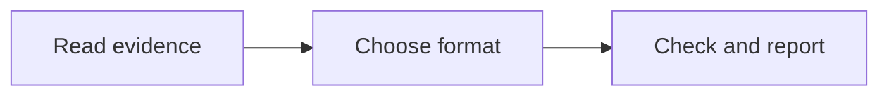
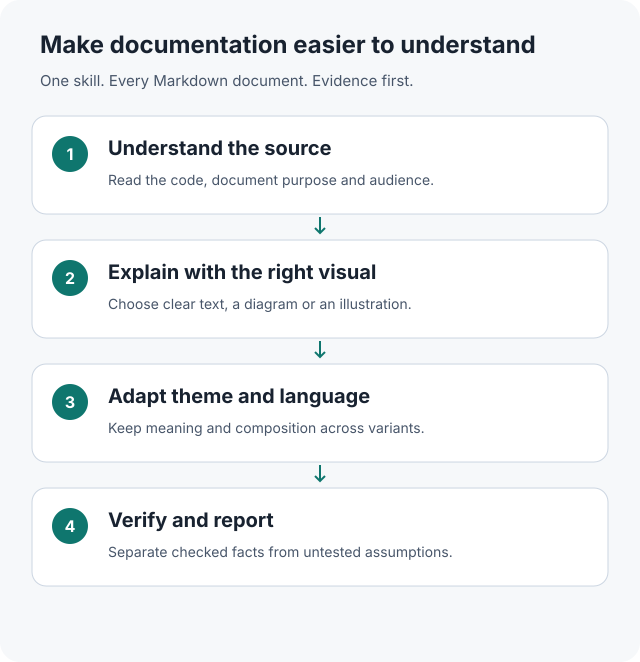

# Advanced formatting showcase

English · [ไทย](advanced-formatting.th.md)

A rendering fixture, not evidence that GitHub rendering was tested. Data and issue numbers are illustrative; conversation-only syntax stays inside code blocks to avoid unintended workflow effects.

[Guide](../skills/github-markdown-studio/references/advanced-formatting.md) · [Home](../README.md)

<a name="tables"></a>

## Tables

| Field | Meaning | Example |
| :--- | :--- | ---: |
| `count` | Number of items | 3 |
| `pattern` | Literal pipe | `a\|b` |

<a name="collapsed-sections"></a>

## Collapsed sections

<details>
<summary>Optional diagnostic context</summary>

Keep required setup and warnings outside this section.

```text
Illustrative diagnostic output, not an executed command.
```

</details>

<a name="code-blocks"></a>

## Code blocks

```python
value = 2 + 3
print(value)
```

````markdown
```python
print("nested fence example")
```
````

```diff
- old_label = "Draft"
+ old_label = "Reviewed"
```

<a name="diagrams"></a>

## Diagrams

Read the evidence, choose a format, then check and report the result. Both maps place one synthetic point at longitude 0°, latitude 0° in the Atlantic Ocean. The STL shows a single open triangle. A printable solid would need a closed surface.



```geojson
{"type":"FeatureCollection","features":[{"type":"Feature","properties":{"label":"synthetic"},"geometry":{"type":"Point","coordinates":[0,0]}}]}
```

```topojson
{"type":"Topology","objects":{"sample":{"type":"Point","coordinates":[0,0]}},"arcs":[]}
```

```stl
solid sample_triangle
  facet normal 0 0 1
    outer loop
      vertex 0 0 0
      vertex 1 0 0
      vertex 0 1 0
    endloop
  endfacet
endsolid sample_triangle
```

<a name="mathematics"></a>

## Mathematical expressions

Here x is a scalar and n is a positive integer.

Inline: $a^2 + b^2 = c^2$. Protected inline: $`x_{i} + y_{i}`$.

$$
f(x) = x^2
$$

```math
\sum_{i=1}^{n} i = \frac{n(n+1)}{2}
```

<span>$</span>10: $10/2=5$. $`\$5`$.

<a name="autolinks"></a>

## Autolinked references

These placeholders demonstrate conversation syntax. In a repository file, use an explicit verified URL, such as the [initial implementation PR](https://github.com/whale-devx/github-markdown-studio-skills/pull/1).

```text
#123
GH-123
owner/repo#123
owner/repo@<verified-commit-sha>
```

<a name="attachments"></a>

## Attaching files

[Local diagram source](workflow.json). This is a repository file link, not a new uploaded attachment. Uploads require permission and the actual returned URL.

<a name="task-lists"></a>

## Task lists

- [x] Write this illustrative example
- [ ] Perform actual GitHub rendering review

Ordinary Markdown tasks remain useful; retired tasklist blocks are not used.

<a name="permalinks"></a>

## Permanent code links

[Python source at the base revision](https://github.com/whale-devx/github-markdown-studio-skills/blob/e921dd88511db4361980b5cd4531001a9576dd93/skills/github-markdown-studio/scripts/capability_plan.py#L1-L5) · [Markdown source lines](https://github.com/whale-devx/github-markdown-studio-skills/blob/e921dd88511db4361980b5cd4531001a9576dd93/README.md?plain=1#L1-L5)

These are links, not embedded code snippets in this Markdown file.

<a name="keywords"></a>

## Keywords and workflow effects

Inert examples only. PR-description closing keywords need a default-branch target; duplicate markers belong in a new issue/PR comment. No issue is closed by this file.

```text
Closes #123
Fixes owner/repo#456
Resolves #123, resolves owner/repo#456
Duplicate of #123
```

<a name="related"></a>

## Related formatting and themes

> [!NOTE]
> A static audit does not verify live rendering.

[Jump to the table](#tables). A footnote keeps a secondary explanation nearby.[^review]

<picture>
  <source media="(prefers-color-scheme: dark)" srcset="assets/workflow.en.dark.svg">
  <source media="(prefers-color-scheme: light)" srcset="assets/workflow.en.light.svg">
  
</picture>

[^review]: These examples do not claim browser or language-expert verification.
