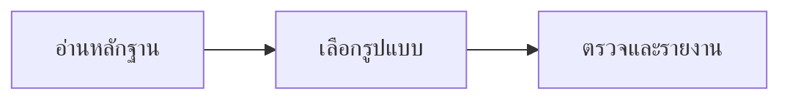
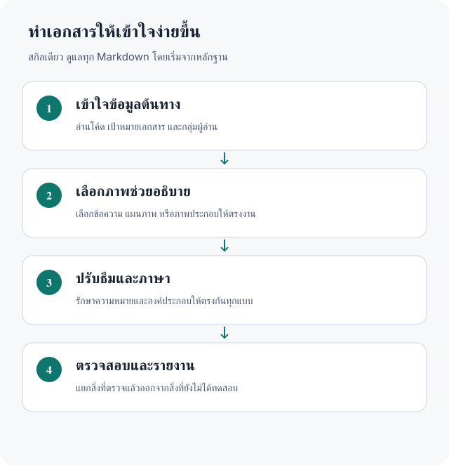

# ตัวอย่างรูปแบบขั้นสูงบน GitHub

[English](advanced-formatting.en.md) · ไทย

ไฟล์ตัวอย่างสำหรับตรวจการแสดงผล ไม่ใช่หลักฐานว่าทดสอบบน GitHub แล้ว ข้อมูลและหมายเลข issue เป็นตัวอย่าง โดยเก็บ syntax ที่ใช้ในบทสนทนาไว้ใน code block เพื่อไม่ให้เกิดผลกับ workflow โดยไม่ตั้งใจ

[Guide](../skills/github-markdown-studio/references/advanced-formatting.md) · [Home](../README.md)

<a name="tables"></a>

## ตาราง

| ฟิลด์ | ความหมาย | ตัวอย่าง |
| :--- | :--- | ---: |
| `count` | จำนวนรายการ | 3 |
| `pattern` | อักขระ pipe | `a\|b` |

<a name="collapsed-sections"></a>

## ส่วนพับได้

<details>
<summary>รายละเอียดการตรวจเพิ่มเติม</summary>

อย่าซ่อนขั้นตอนเริ่มต้นที่จำเป็นหรือคำเตือนไว้ในส่วนนี้

```text
ข้อความผลตรวจตัวอย่าง ไม่ใช่ผลจากคำสั่งที่รันจริง
```

</details>

<a name="code-blocks"></a>

## บล็อกโค้ด

```python
value = 2 + 3
print(value)
```

````markdown
```python
print("nested fence example")
```
````

```diff
- old_label = "Draft"
+ old_label = "Reviewed"
```

<a name="diagrams"></a>

## แผนภาพ

เริ่มจากอ่านหลักฐาน เลือกรูปแบบ แล้วตรวจและรายงานผล แผนที่ทั้งสองวางจุดสมมติหนึ่งจุดที่ลองจิจูด 0° ละติจูด 0° ในมหาสมุทรแอตแลนติก ส่วนไฟล์ STL แสดงสามเหลี่ยมเปิดหนึ่งหน้า โมเดลตันสำหรับพิมพ์สามมิติต้องมีผิวปิด



```geojson
{"type":"FeatureCollection","features":[{"type":"Feature","properties":{"label":"synthetic"},"geometry":{"type":"Point","coordinates":[0,0]}}]}
```

```topojson
{"type":"Topology","objects":{"sample":{"type":"Point","coordinates":[0,0]}},"arcs":[]}
```

```stl
solid sample_triangle
  facet normal 0 0 1
    outer loop
      vertex 0 0 0
      vertex 1 0 0
      vertex 0 1 0
    endloop
  endfacet
endsolid sample_triangle
```

<a name="mathematics"></a>

## นิพจน์คณิตศาสตร์

กำหนดให้ x เป็นสเกลาร์ และ n เป็นจำนวนเต็มบวก

นิพจน์ในบรรทัด: $a^2 + b^2 = c^2$ แบบป้องกัน syntax ชนกับ Markdown: $`x_{i} + y_{i}`$.

$$
f(x) = x^2
$$

```math
\sum_{i=1}^{n} i = \frac{n(n+1)}{2}
```

<span>$</span>10: $10/2=5$. $`\$5`$.

<a name="autolinks"></a>

## การอ้างอิงอัตโนมัติ

ข้อความสมมติเหล่านี้แสดง syntax สำหรับบทสนทนา ในไฟล์ repository ให้ใช้ URL ที่ตรวจแล้ว เช่น [PR ของการพัฒนารุ่นแรก](https://github.com/whale-devx/github-markdown-studio-skills/pull/1)

```text
#123
GH-123
owner/repo#123
owner/repo@<verified-commit-sha>
```

<a name="attachments"></a>

## การแนบไฟล์

[ต้นฉบับแผนภาพใน repository](workflow.json) เป็นลิงก์ไฟล์ที่มีอยู่ ไม่ใช่ไฟล์แนบที่อัปโหลดใหม่ การอัปโหลดต้องได้รับอนุญาตและใช้ URL ที่ระบบส่งกลับจริง

<a name="task-lists"></a>

## รายการงาน

- [x] เขียนตัวอย่างนี้
- [ ] ตรวจการแสดงผลบน GitHub จริง

ใช้รายการงาน Markdown ปกติ ไม่ใช้ Tasklist blocks ที่เลิกใช้แล้ว

<a name="permalinks"></a>

## ลิงก์ถาวรไปยังโค้ด

[Python source at the base revision](https://github.com/whale-devx/github-markdown-studio-skills/blob/e921dd88511db4361980b5cd4531001a9576dd93/skills/github-markdown-studio/scripts/capability_plan.py#L1-L5) · [Markdown source lines](https://github.com/whale-devx/github-markdown-studio-skills/blob/e921dd88511db4361980b5cd4531001a9576dd93/README.md?plain=1#L1-L5)

ลิงก์เหล่านี้ไม่ใช่ code snippet ที่ฝังและขยายอัตโนมัติในไฟล์ Markdown นี้

<a name="keywords"></a>

## คำสำคัญและผลต่อ workflow

ตัวอย่างไม่มีผลกับ workflow คำสั่งปิด issue ในคำอธิบาย PR ต้องมีเป้าหมายเป็น default branch ส่วนการระบุงานซ้ำใช้ใน comment ใหม่ของ issue/PR ไฟล์นี้ไม่ได้ปิด issue ใด

```text
Closes #123
Fixes owner/repo#456
Resolves #123, resolves owner/repo#456
Duplicate of #123
```

<a name="related"></a>

## รูปแบบเพิ่มเติมและธีม

> [!NOTE]
> การตรวจแบบ static ไม่ได้ยืนยันการแสดงผลจริง

[กลับไปที่ตาราง](#tables) เชิงอรรถช่วยแยกคำอธิบายรองออกจากเนื้อหาหลัก[^review]

<picture>
  <source media="(prefers-color-scheme: dark)" srcset="assets/workflow.th.dark.svg">
  <source media="(prefers-color-scheme: light)" srcset="assets/workflow.th.light.svg">
  
</picture>

[^review]: ตัวอย่างเหล่านี้ไม่ได้อ้างว่าผ่านการตรวจด้วยเบราว์เซอร์หรือผู้เชี่ยวชาญภาษาแล้ว
